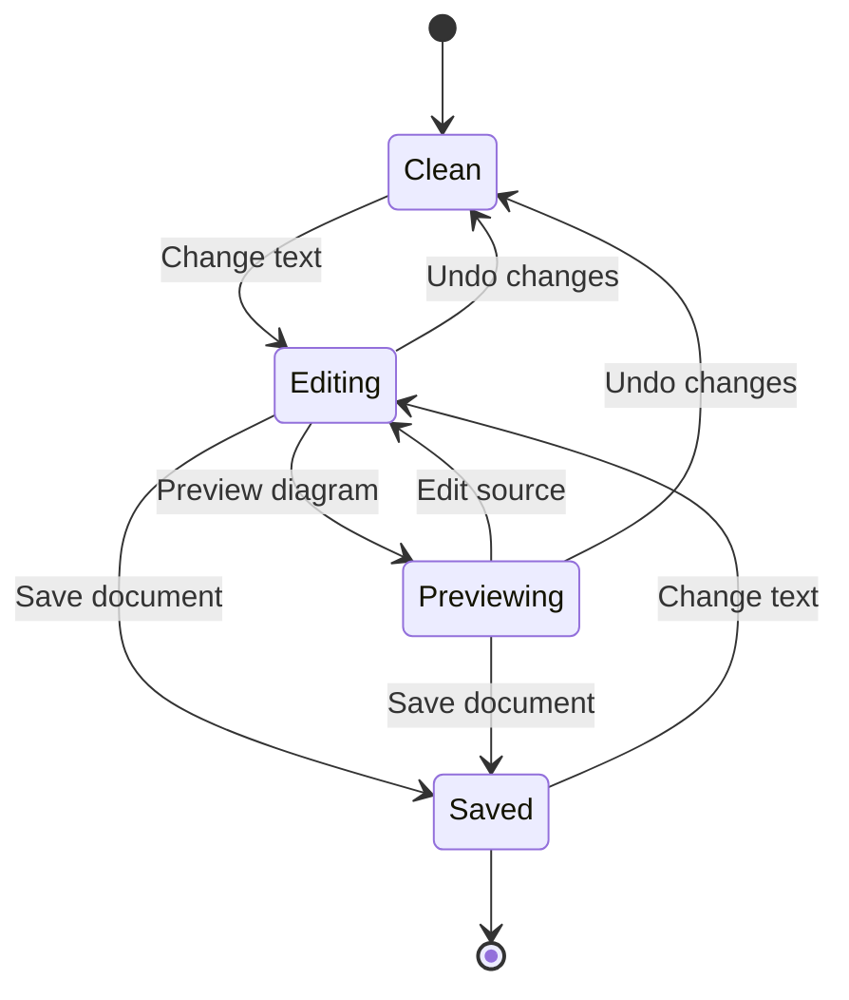
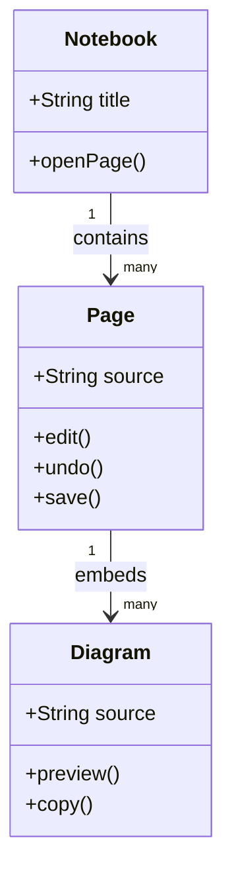
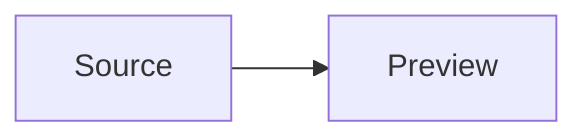

# Atlas: design notes

This companion note adds state and class diagrams to the [release notebook](mermaid-notes-showcase.md#release-flow). Use the links to test opening another Markdown file at a specific heading.

## Document lifecycle



> Preview is a display choice, not a save operation. If the document was changed before Preview, it should still be changed afterward.

### Small interaction exercise

- [ ] Click Edit on the state diagram.
- [ ] Rename `Previewing` to `Reading` everywhere in that fence.
- [ ] Click Preview and inspect the new chart.
- [ ] Undo the edit and confirm the original returns.

## Class model

The page owns the diagram's source. A preview renderer consumes that source and produces a disposable image; it does not become a second document.



### Responsibilities

| Component | Owns | Does not own |
| --- | --- | --- |
| Page | Source text and edit history | A separate diagram document |
| Diagram preview | Cached pixels | Saving or discarding edits |
| Worker | Parsing and rendering work | Keyboard focus |
| Link navigation | Destination file and section | Replacing unsaved content |

## Navigation checks

Try the links in both the list and the table. They should land on the requested section even if the other file has not been opened yet.

1. [Release checklist](mermaid-notes-showcase.md#release-checklist)
2. [Request sequence](mermaid-notes-showcase.md#request-sequence)
3. [Data model](mermaid-notes-showcase.md#data-model)
4. [Return to the lifecycle](#document-lifecycle)

| Destination | Link |
| --- | --- |
| Release flow | [Open section](mermaid-notes-showcase.md#release-flow) |
| Review coverage | [Open section](mermaid-notes-showcase.md#review-coverage) |
| Class model | [Jump here](#class-model) |

## Literal source example

The outer fence below is a documentation example. It should remain literal code rather than create another diagram.

````markdown

````

---

[Return to the full release notebook](mermaid-notes-showcase.md#release-flow)