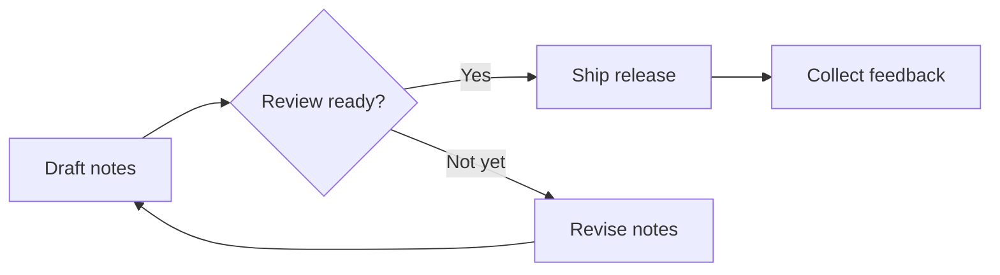
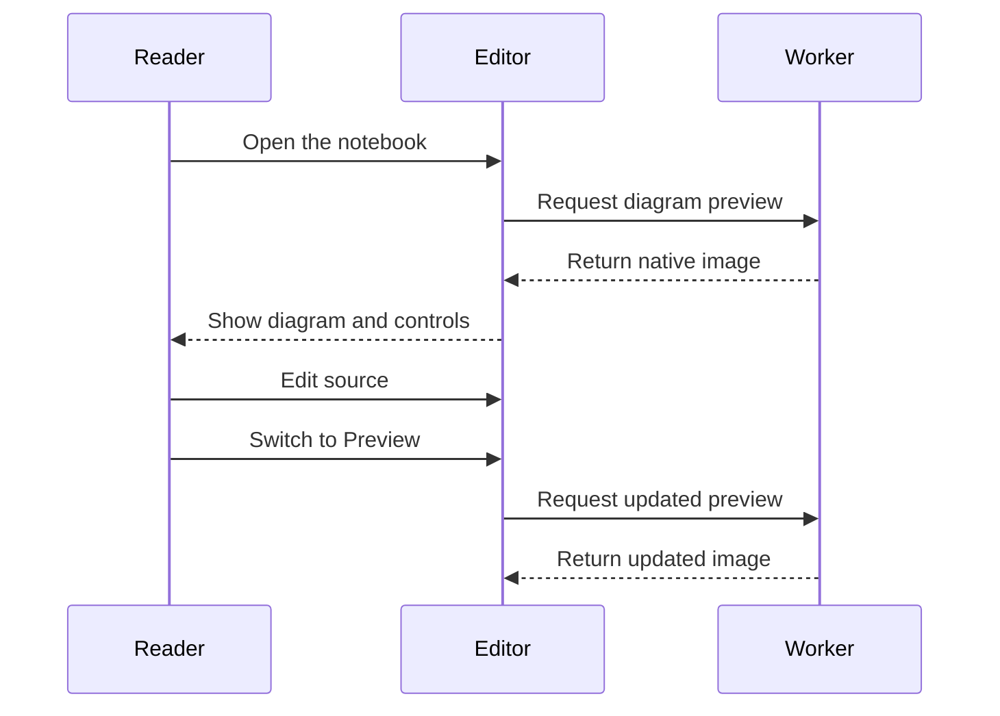
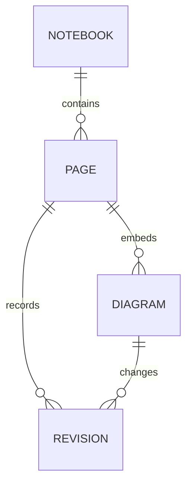
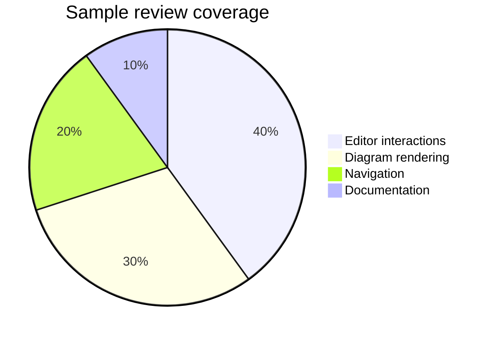

# Atlas: release notebook

A small product notebook mixing **native Mermaid diagrams**, ordinary Markdown, editable tables, code, checklists, and section links. Nothing here calls an external service.

## Release flow



Click **Edit** beside Copy to change a diagram's source, then **Preview** to return to the chart. Try changing `Ship release` to `Ship Atlas` and undoing the edit.

Jump to [request sequence](#request-sequence), [data model](#data-model), [release checklist](#release-checklist), or [design notes](mermaid-design-notes.md#document-lifecycle).

---

## Release checklist

- [x] Put diagrams next to the explanation, not in a separate browser.
- [x] Keep the original Mermaid source editable.
- [ ] Review the request sequence below.
- [ ] Rename a diagram label and switch back to Preview.
- [ ] Follow a cross-file section link and come back.

> Working agreement: previewing a diagram must not save the file or discard local changes. A diagram is just another view of its fenced source.

### Review notes

This paragraph has two deliberate spelling examples: **mispelled** and **recieve**. Right-click a red-underlined word to try a correction, Ignore Word, or Add to Dictionary. The same text in `mispelled` is code and should not receive a spelling underline.

| Area | Owner | Status | Next action |
| --- | --- | --- | --- |
| Notes | Editor team | Ready | Check Edit and Preview |
| Agent replies | Agent team | Ready | Follow a section link |
| Storage | Platform team | Reviewing | Confirm undo history |
| Release | Everyone | Pending | Collect feedback |

## Request sequence

The window keeps input responsive while a worker prepares the diagram. The source stays in the document throughout the interaction.



### Ordinary code still looks like code

The following is a regular Rust fence, not a diagram. Its Copy button should remain available without Mermaid editing controls.

```rust
struct Release {
    name: String,
    approved: bool,
}

fn ready_to_ship(release: &Release) -> bool {
    release.approved && !release.name.trim().is_empty()
}
```

## Data model

A notebook contains pages; a page can embed multiple diagrams. Each diagram keeps its own editable source.



1. Open the page.
2. Scroll to the diagram you want to change.
3. Click Edit and change a label.
4. Click Preview, then undo to compare the original.

For implementation-oriented diagrams, see the [document lifecycle](mermaid-design-notes.md#document-lifecycle) and [class model](mermaid-design-notes.md#class-model) in the companion file.

## Review coverage

These numbers are sample data for the chart, not application performance measurements.



| Example | What to try |
| --- | --- |
| Flowchart | Edit a node label, Preview, then undo |
| Sequence | Copy the original Mermaid source |
| Data model | Resize the window and scroll through the chart |
| Pie chart | Change a value and compare the preview |
| Section links | Jump within this file and into the companion file |

## Wrap-up

**The goal:** diagrams should feel like part of a normal note. Text, tables, code, and charts stay together, and editing a chart never requires leaving the document.

[Back to the release flow](#release-flow) | [Open design notes](mermaid-design-notes.md#document-lifecycle)